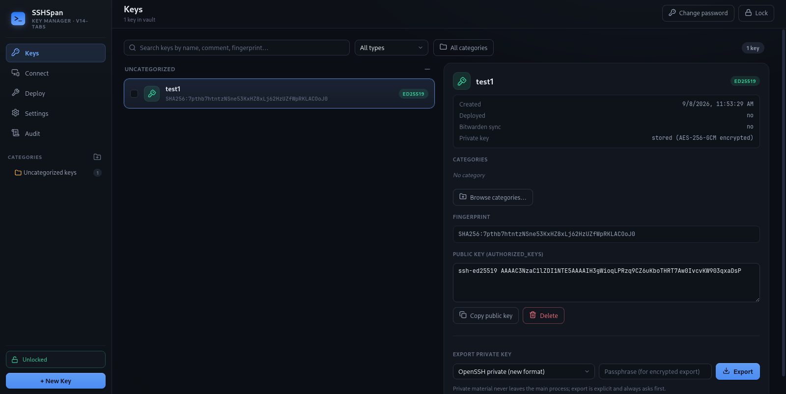
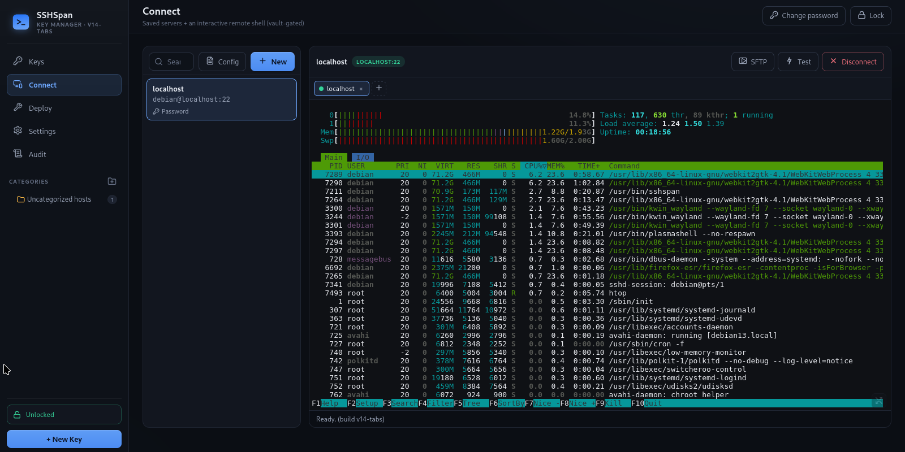
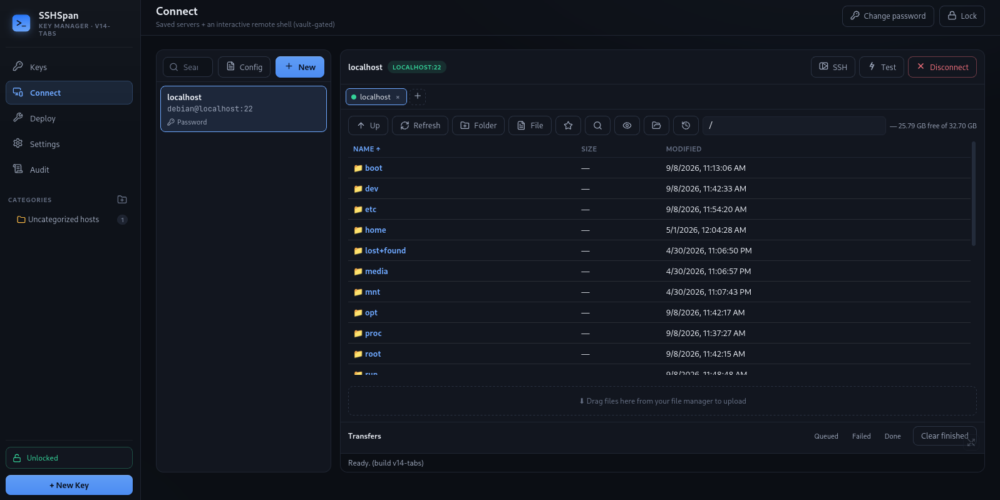
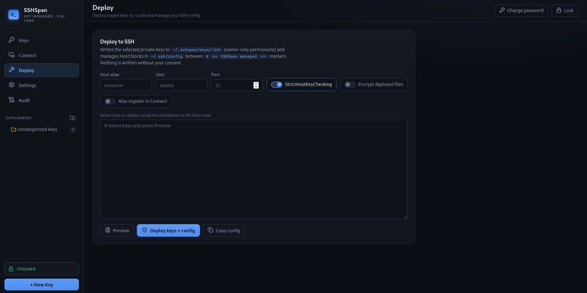
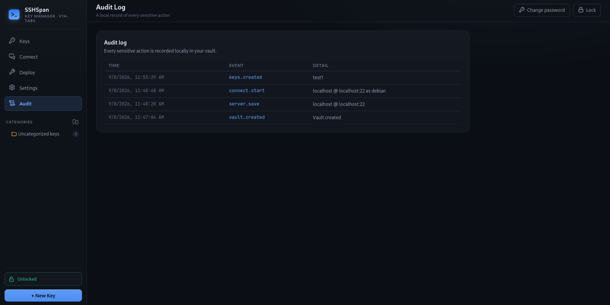
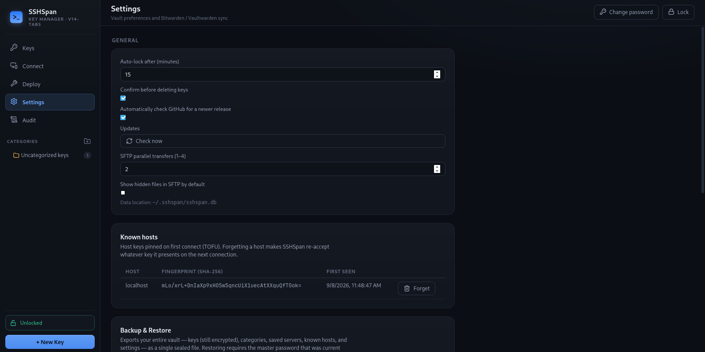

<p align="center">
  
</p>

# SSHSpan

> **Unreleased changes.** This branch is the flaw-remediation pass over v1.9.1 that followed an
> eight-area internal audit on 2026-10-09. It has not been released or version-bumped: the
> manifests still say 1.9.1. What changed is in the [changelog](CHANGELOG.md#unreleased); the
> status of every finding is in the [finding index](docs/audit/2026-10-09/README.md) and the
> [audit report](docs/audit/2026-10-09/REPORT.md); [Known limitations](#known-limitations) lists
> what the pass does not fix.

Cross-platform SSH key manager, SSH client, and SFTP file transfer tool for the desktop -
built on **Rust + Tauri v2** (Windows and Linux).

SSHSpan gives you a single, encrypted home for every SSH key you own, a PuTTY-grade terminal
to use them, and a FileZilla-style file browser over the same live connection. Generate new
keys, import existing ones, organize keys and servers into separate category trees, deploy
keys to `~/.ssh/` with matching `Host` blocks in SSHSpan's managed SSH config (you add one
`Include` line to your own `~/.ssh/config` to use them), connect to your servers, and move
files - all from one keyboard-friendly app. Private keys are encrypted at rest with
AES-256-GCM behind a master password; the master password itself lives only in memory and the
vault auto-locks after 15 minutes without a key press, click, scroll or touch by default
(locking closes every live SSH session and pauses transfers, so a warning appears 60 seconds
before an idle lock and a lock you start in the window asks first while sessions or transfers
are live).

All sensitive logic - crypto, vault, database, SSH, SFTP - runs in a compiled **Rust** core.
The UI is vanilla HTML/CSS/JS in your OS webview: no Electron, no bundled Chromium, no Node
runtime, and no WebView DevTools in release builds. The Windows installer is ~9 MB. There is no
telemetry and no cloud service. The network connections SSHSpan can make are: SSH/SFTP sessions
to the servers you use, the update check against GitHub (on by default, disableable in
Settings) and - only if you enable them - Bitwarden sync (to the server you configure), an AI
provider (your chat, session details and recent terminal text) and MCP servers. See
[docs/PRIVACY.md](docs/PRIVACY.md). Installers are checked against a SHA-256 digest and a
minisign signature before they run and a missing or invalid signature refuses the update;
[docs/SECURITY.md](docs/SECURITY.md) explains what that does and does not protect.

## What's new

- **Unreleased** - A flaw-remediation pass over v1.9.1 driven by an eight-area internal audit
  ([report](docs/audit/2026-10-09/REPORT.md), [finding index](docs/audit/2026-10-09/README.md),
  [every change](CHANGELOG.md#unreleased)). Confirmations and the idle auto-lock now work (the
  native `confirm()` guards were no-ops and the idle lock never fired); secret files can be
  written on Windows; backups are written and read by Rust behind native dialogs; the AI
  assistant can no longer press Enter and MCP approvals are bound to the definition you
  reviewed; deploy shows and writes the same OpenSSH-safe text and removes what it wrote;
  editing a server keeps its saved password and "Config" import reads your real
  `~/.ssh/config`; there is a Quit command, an exit teardown and an updater that binds the
  signature to the release; Bitwarden sync keeps data and reports what it did; SFTP transfers
  report a short copy as an error (SHA-256 verification is opt-in), edit-in-editor saves are
  checked for conflicts and local paths are confined; and the app has keyboard and
  screen-reader support (not tested with a screen reader).
  The SFTP file browser fits the default (1100x720) and minimum (880x560) window sizes, and
  in-page drag and drop uses pointer events, so it does not depend on the HTML5 drag events the
  Windows webview withholds; every drag also has a menu command.
  Credentials are bound to their destination by native questions that the page cannot answer
  (on Windows and macOS the default button is "Don't allow"; the GTK dialog on Linux sets none),
  and the Bitwarden sync now asks which server and account it may upload your keys and saved
  passwords to. A saved SSH password follows its account only, an approval for Bitwarden changes
  applies exactly the list you were shown, "Stop editing" no longer deletes changes the server does
  not have, and the deploy sheet shows the warnings and your own matching `Host` lines.
  Bitwarden accounts that use Argon2id can log in: SSHSpan read the memory setting in the wrong
  unit, so only accounts set to 16 MiB could. A server whose key file is
  protected by a passphrase says what to do instead of failing with a decoding error, and save
  dialogs open in your Downloads folder. A path picked in a save dialog is checked against the
  protected places like a typed one, and that now holds for the private-key export and "Create
  backup..." too (`~/.ssh` stays allowed for them). On Windows a key file is read only from this
  computer's drives.
  Nothing here is released or version-bumped.
- **v1.9.1** - Remote MCP servers for the AI assistant, plus fixes to the
  assistant panel and MCP integration. The assistant can attach remote MCP
  servers over Streamable HTTP (MCP 2025-11-25) and use their tools next to
  the built-in ones: per-tool approval with a SHA-256 pin that disables and
  demands re-approval if a definition changes, static auth (none / bearer /
  custom header / environment variable), a Rust-side call gate by access
  level (the human approval click itself is attested by the renderer),
  every result wrapped as untrusted data,
  and audit logging of every call by argument hash. MCP audit fixes cover
  credential origin binding, vault-lock generation checks, authenticated
  session teardown, input-schema persistence, aggregate tool caps, canonical
  collision handling, and immediate list-change refresh. The active access-level
  button and YOLO dialog are now legible, and MCP command argument casing is
  explicit and runtime-tested.
- **v1.9.0** - Audit remediation and the AI assistant. Two critical defects
  fixed: Bitwarden sync aborted every healthy run with a bogus "vault was locked"
  error (an inverted flag in the lock gate), and restoring a backup silently dropped
  each server's Bitwarden linkage - the next sync then pushed duplicates of every
  server into the vault (a SQL INSERT that bound 17 values against 14 placeholders,
  which sqlx swallows without erroring). Also: a vault lock racing an in-flight SFTP
  open no longer leaves a live channel behind, right-click at the prompt no longer
  pastes unconfirmed multi-line clipboard contents (and no longer double-pastes via
  the context menu), "Restart session" on a live tab no longer doubles every
  keystroke and loses close-detection, window resizes no longer steal focus from
  dialogs, the wheel no longer prints `^[[A^[[A` garbage inside `screen`/`tmux`,
  Split mode no longer half-disables the file browser, "Confirm before deleting a
  key" and the update-check opt-out actually take effect now, and the keyboard
  compatibility settings (rxvt Home/End, application cursor keys, keypad) were
  said to take effect (the audit later found they changed only the local display, not the
  session; fixed in the unreleased changes above). The AI assistant lands in this release: a
  chat panel docked beside the terminal (Ctrl+Shift+A) for OpenAI- and Anthropic-compatible
  providers, with a per-tab access level (Read / Draft / Execute / YOLO) chosen
  on a color-coded control - YOLO behind a red opt-in dialog - a vault-sealed
  API key, a Rust-side gate that refuses command execution below the Execute
  level, and audit logging of every command.
  Terminal output reaches the model only as untrusted data (a per-turn
  nonce-wrapped block the payload cannot forge), so text printed on the remote
  cannot pose as instructions.
- **v1.8.0** - UX pass over the whole renderer. The navigation is two objects (Keys,
  Servers) plus Settings: Deploy is now an action on the keys you have selected rather
  than a destination you visit afterwards, and the audit log is a Settings section. A Ctrl+K
  command palette searches keys, servers and categories and runs actions. The key list
  leads with each key's comment instead of its fingerprint, export moves to its own tab
  with a per-format Secret/Sealed/Public marker and a passphrase field that appears only
  when the format uses one, sessions gain a Shell/Files/Split surface control, the remote
  path is a clickable breadcrumb, and Settings is sectioned with one toggle component
  throughout. Two bugs fixed along the way: the search box did nothing in the default
  grouped key view, and the deploy preview joined its lines on a literal `\n`.
  Also in this release: the Send-to folder scan is bounded by progress rather
  than a flat 120s cap, and rustls is bumped to 0.23.45 for RUSTSEC-2026-0285.
- **v1.7.3** - Security release resolving a full source audit: the renderer-to-native
  executable-staging chain is closed, a vault lock now revokes in-progress connects/exports/
  syncs (not just live sessions), master-password rotation is atomic and covers the
  Bitwarden credential, download resume can no longer follow a planted `.part` symlink,
  recursive uploads re-check every descendant, backups no longer import local deletion
  paths, the updater resolves the signature from the right URL and binds the version to the
  asset, and Bitwarden Argon2id now matches the official client. Plus the SFTP queue's
  pause/resume, auto-retry, throttle, persistence, and integrity verification, richer remote
  listings, and a round of renderer/UI fixes.
- **v1.7.2** - Signed auto-updates (minisign-verified installers, fail-closed), consent-based
  host-key trust with strict refusals, private-key export straight to a file (never through
  the UI process), brute-force backoff, hardened staging and paths, plus the SFTP
  FileZilla-parity set: resumable transfers, conflict dialogs, directory comparison with
  synchronized browsing, drag & drop, and timestamp preservation.
- **v1.7.1** - Security patch: real PBES2 PKCS#8 export, SSRF and data-loss fixes, a verified
  auto-update path, and an XSS fix.
- **v1.7.0** - PuTTY-style terminal utilities: right-click terminal/tab context menu, copy
  all, paste confirmation, duplicate/restart sessions, configurable scrollback, bell
  behavior, keyboard compatibility settings, SSH keepalive, and normal remote Tab
  completion through an explicit `TERM=xterm-256color` + UTF-8 PTY setup.
- **v1.6.0** - Separate key and host categories: the Keys view and the Servers view
  each get their own category tree with independent recursive filters and uncategorized
  counts. Scope is enforced everywhere (assignments, parents, backup/restore) and syncs to
  Bitwarden under a separate `Hosts-` namespace. Plus a compact, keyboard-accessible
  category picker.
- **v1.5.0** - SFTP reaches FileZilla parity: background transfer queue, dual-pane browsing,
  chmod dialog, recursive search, per-server bookmarks, multi-select, sorting, remote disk
  usage, and SFTP keep-alive.
- Full history in the [changelog](CHANGELOG.md).

## Known limitations

What this branch does not do or does not guarantee, with the reason. The security-relevant ones
are explained further in [docs/SECURITY.md](docs/SECURITY.md#accepted-risks-and-limitations),
which lists every accepted risk; the status of every audit finding is in the
[finding index](docs/audit/2026-10-09/README.md).

- **Key import formats.** Only OpenSSH private keys and PuTTY `.ppk` files can be imported,
  because each new key parser needs its own review (A7-03). PKCS#1, SEC1 and PKCS#8 private keys
  are refused with a message that says how to convert them; public keys and `authorized_keys`
  lines are refused with a message that asks for the matching private key.
- **No migration of Electron-era vaults.** The Rust app (1.3.6 and later) seals its vault
  differently from the Electron app (1.2.0 and earlier; Argon2id and HKDF instead of scrypt) and
  keeps it in a different place, and there is no importer. Export the keys from the Electron app
  and import them (A7-58).
- **Local paths are deny-listed, not granted.** SFTP download destinations, upload sources and
  local-pane changes are paths the page supplies. Paths built from remote names are confined to
  the folder you chose, and every path is checked against a list of protected locations, but a
  location that is not on the list (for example `~/.aws`) is still reachable by a compromised
  page; no SFTP local path is bound to a native dialog: "Download as..." uses up the save dialog's
  one-use grant when there is one, but a target without one is accepted under the same deny-list
  (A6-02). On Windows a path given as a network share (`\\host\...`) for an SFTP local path, or for
  a file to open with the system's default program (`system_open_external`), can make Windows sign
  in to that host when SSHSpan checks it; shares are not refused, so browsing a NAS in the local
  pane keeps working.
- **Approvals are attested by the page.** A compromised page can claim that a human clicked
  Approve for an AI command, an MCP tool call or an update, and Rust cannot observe the click.
  Destinations for secrets are therefore bound in Rust where that matters (the native
  questions - for an MCP credential, a stored API key and the Bitwarden sync destination - the
  saved-password account binding, the Bitwarden approval token); the rest is
  documented here and in [docs/SECURITY.md](docs/SECURITY.md#accepted-risks-and-limitations)
  rather than claimed as a control.
- **Sleep does not lock the vault.** Tauri v2 exposes no suspend or lock event of the operating
  system on the desktop, so suspending or locking the computer leaves the vault unlocked until
  the idle timer, the lock command or the tray's Lock ends it.
- **Secrets in memory.** The master password and decrypted keys are in memory while the vault is
  unlocked, so a memory dump taken then exposes them. The SSH library keeps a password or
  keyboard-interactive answer in its send buffer until it is overwritten, and SSHSpan cannot
  wipe that copy (A6-11).
- **Updates.** The download shows no progress bar (A5-22). The verified installer is started by
  path from your temp folder, so code running as you could swap it in that moment; the Windows
  UAC prompt is not a boundary against that.
- **Key files on Windows.** A server's key file is read from any drive letter, a mapped network
  drive included (`C:\...`, `C:/...`, `\\?\C:\...`); every other spelling is never opened: a share
  or device (`\\server\share\...`, `\\?\UNC\...`, `\??\...`, `\\.\...`), another prefix
  (`\\?\Volume{...}`, `\\?\C:/...`) or a relative path (`key`, `\key`, `D:key`). The save warns and
  Connect and Test connection refuse, so a key on a share needs a mapped drive letter or a local
  copy.
- **Edit in your editor.** Saving needs write permission in the file's folder and replaces the
  file, so ownership, ACLs and hard links are not kept. A conflict is detected by size and
  modification time (in whole seconds), so a same-size change in the same second is not noticed.
  Closing the tab, disconnecting or losing the session, or locking the vault ends every edit at
  once and deletes the local copies, saves that did not reach the server included; only "Stop
  editing" asks first. A save that lands in the instant between the "Stop editing" check and the
  delete is lost, and an Edit of the same file that lands in the instant before "Stop editing"
  marks it as being closed hands your editor a copy that the stop then deletes.
- **Bitwarden.** The server must be reachable over HTTPS by a public hostname. Deletions are never
  propagated. Test connection needs an unlocked vault. An older copy of a server stays
  reported on every sync until you delete it in Bitwarden. A category change waiting for the
  next sync is remembered on this computer only: it is not in a backup, so a restore does not
  carry it and the next category change marks again. With a system proxy set (`HTTP_PROXY` and
  `HTTPS_PROXY`, or the Windows proxy setting) the proxy resolves the vault's host name, so the
  connect-time check against private addresses does not apply; the check when the URL is saved or
  tested still runs ([docs/SECURITY.md](docs/SECURITY.md#accepted-risks-and-limitations)).
- **MCP servers.** Streamable HTTP only. The backend does not check a tool call's arguments for
  characters that disguise text; the approval card shows them escaped. Revoking a tool while its
  call is already on the wire cannot stop that call. The tools of a server that is not confirmed
  are still offered to the model; the backend refuses every call to it. The stored record is
  checked right before each request, never during one: a request already out is not recalled,
  and the "method not found" answers to a server's own requests inside an open response and the
  DELETE that ends a session are not checked against the record (the answers go to the same
  endpoint within the same exchange, at most eight per response, and stop at a vault lock; a
  DELETE only ends a session). When more than 16 session teardowns are pending at once, the rest
  are not sent and those sessions expire on their servers.
- **Native credential questions.** An "Allow" counts only after the dialog has been open for one
  second, measured from the moment the dialog is requested on the main thread. On Linux (GTK)
  the dialog is created from an idle callback, so a flooded main loop can use up part of that
  second before the dialog is visible. On Windows and macOS a stray Enter answers "Don't allow"
  (the default button); the GTK dialog sets no default button, so only a deliberate click on
  "Allow" can come early.
- **Locking.** Locking ends live sessions, so a long unattended job is still cut at the idle
  timeout.
- **What the tests do not exercise.** The renderer suites run in headless Chromium against stubbed
  IPC. Native dialogs, the tray, WebView2 and WebKitGTK rendering, screen readers, and real SSH,
  SFTP, Bitwarden and MCP servers were not exercised. The Rust library and integration tests have
  also run natively on Windows 11, from test executables cross-built in WSL (see
  [CONTRIBUTING.md](CONTRIBUTING.md)). The `windows-latest` CI job passed on a runner for the
  first time on 2026-10-17 (743 library, 47 integration and 20 MCP integration tests, natively);
  its first run had failed five tests that assumed Unix paths or a single ACL entry, since fixed.
  It is still `continue-on-error`; that flag can now be removed. Drag and drop is emulated: the
  suites remove the HTML5 drag events the Windows webview withholds and drive a real mouse, and no
  real WebView2 drag was run. The exit-time wait for MCP session teardowns (quit with a connected
  MCP server) needs a manual check on Windows.

## Screenshots

A quick tour of the desktop UI. These predate the UX pass described under *What's new* -
Deploy is now a sheet over the key list and the audit log is a Settings section, so those
two shots no longer match a view you can navigate to.

<table>
  <tr>
    <td width="50%"></td>
    <td width="50%"></td>
  </tr>
  <tr>
    <td align="center"><strong>Keys and categories</strong><br>Manage encrypted keys in scoped category trees.</td>
    <td align="center"><strong>Embedded SSH client</strong><br>Connect with a saved server and use the integrated terminal.</td>
  </tr>
  <tr>
    <td width="50%"></td>
    <td width="50%"></td>
  </tr>
  <tr>
    <td align="center"><strong>SFTP file browser</strong><br>Browse remote files, use the dual-pane view, and queue transfers.</td>
    <td align="center"><strong>SSH deployment</strong><br>Preview and manage generated SSH config entries.</td>
  </tr>
  <tr>
    <td width="50%"></td>
    <td width="50%"></td>
  </tr>
  <tr>
    <td align="center"><strong>Audit log</strong><br>Review an append-only record of sensitive vault and connection actions.</td>
    <td align="center"><strong>Settings</strong><br>Configure transfer concurrency and other desktop preferences.</td>
  </tr>
</table>

## Features

### Keys
- **Generate** - RSA (the dialog offers 3072, 4096 and 8192 bits; the backend accepts
  2048-8192), Ed25519, ECDSA (nistp256/384/521), via the audited `ssh-key` Rust crate.
- **Import** - browse or paste an **OpenSSH private key** (passphrase-protected too) or a
  **PuTTY `.ppk`** (v3 and legacy v2, passphrase-protected too). Nothing else is imported:
  PKCS#1/SEC1/PKCS#8 PEM, public keys and `authorized_keys` lines are refused with a message
  naming what they are. To convert a private PEM, run `ssh-keygen -p -o -f <copy-of-the-key-file>`
  on a **copy** - it rewrites the copy in OpenSSH format and asks for a passphrase to keep or
  set (do not use `-N ""`, which removes the passphrase) - or save a `.ppk` from PuTTYgen. The
  Import dialog names the two supported formats and explains the conversion when it recognises
  another one. PuTTY files are checked for damage (the MAC of an unencrypted `.ppk` is verified
  and a missing one is refused).
- **Export** - OpenSSH new-format private, PuTTY `.ppk` v3, PKCS#8 PEM (plain, or encrypted -
  encrypted refuses an empty passphrase), SPKI PEM public, `authorized_keys` lines. Private
  exports are written by Rust straight to the file you choose; public exports go through the
  native save dialog too, so a cancel exports and audits nothing (save dialogs open in your
  Downloads folder, or your home folder if there is none). OpenSSH and PPK exports take an
  optional passphrase (the tab says the file is unprotected without one). Legacy v2 `.ppk`
  imports are written back as v3, and a passphrase-protected `.ppk` export opens in PuTTY.
- **Names and sizes** - key names must be unique (ignoring case) on create, import and rename;
  RSA sizes outside 2048-8192 are refused and the dialog warns that 4096 and 8192 can take a
  minute.
- **Encrypted vault** - AES-256-GCM envelopes with an Argon2id-derived key (64 MiB, 3 passes,
  4 lanes); the master password is never stored.

### Categories
- Two independent trees: **key categories** for keys, **server categories** for saved servers -
  any depth, drag-and-drop in the sidebar, breadcrumbs, grouped lists, and a shared category
  picker with search and full keyboard navigation (a key can be in several key categories, so
  its picker is multi-select; a server is in one category, so its picker is single-select). A new
  server starts in the host category the list is filtered by, and a saved server that the filter
  hides is announced, as for a new key.
  Dragging uses pointer events, not the HTML5 drag events the Windows webview withholds, and
  every move also has a menu command (Move to..., Move up, Move down; `Alt+ArrowUp` and
  `Alt+ArrowDown` on a focused row do the last two). A drag, Move up or Move down writes the
  order of the whole list it lands in as one `category_set_order` (which never changes a
  parent; a new parent is set first with `category_reparent`, which is all Move to... does), so
  a category dropped beside the root of a restored loop lands where it was dropped and no other
  row changes place (a restored category whose saved parent is in the other tree counts as top
  level in its own).
- The Keys view and Servers view each filter through their own tree, with explicit
  "uncategorized" entries and live recursive counts. A category loop restored from a backup is
  shown and can be repaired, and moving a category into a loop is refused.
  Renaming, moving or deleting a category, or changing a key's categories, marks it for the next
  Bitwarden sync, which uploads the new category path only while Bitwarden's item is unchanged;
  if Bitwarden changed the item too, that change is listed for approval first and the category
  goes up at the next sync. The marks stay on this computer and are not in backups.
- Both trees **sync with Bitwarden**: key categories are encoded into cipher `notes`, server
  categories travel under a separate `Hosts-` namespace, so two SSHSpan installs (or a
  reinstall) converge on the same structure.

### Servers - embedded SSH client
- **Saved servers** with per-server username + SSH-key binding; optional password storage
  (sealed with your vault master, unsealed only in-process at connect time). Editing a server
  keeps its saved password; "Remove saved password" clears it. A saved password belongs to the
  account it was saved for: changing the host, port, user name or authentication method asks for
  the password again (the dialog says so at once and Save stops at the password field until you
  type it or remove the saved one; a key sign-in never asks), the backend refuses an edit that
  skips it, and connecting as another user does not use the saved password.
- **Config import** reads your own `~/.ssh/config` (read-only, one level of `Include`, patterns
  and `Match` blocks skipped) and names the file it read; the host you pick prefills the server
  form, and that form's Save saves it.
- **Key files** - a server can sign in with a key file (a `.pem` path) instead of a vault key.
  SSHSpan cannot ask for a passphrase while connecting, so a key file protected by one (OpenSSH,
  PKCS#8, traditional PEM or PuTTY) is refused at connect with "This key file is protected by a
  passphrase, which SSHSpan cannot ask for when connecting." and what to do: import it under Keys
  (New key > Import asks for the passphrase) and choose that key for the server, or remove the
  passphrase from the file. Saving such a server saves it all the same, and the answer to the save
  carries the same advice as a warning, which the server dialog (the Config import only prefills
  it) and the deploy's "Also save these as servers" show. On Windows SSHSpan reads a key file only
  from this computer's drives: a path like `C:\...` (a mapped drive too) is read; any other
  spelling - a network or device path (`\\server\share\...` and the like), another prefix or a
  relative path (`key`, `D:key`) - is never opened. Saving such a server saves it and
  warns "SSHSpan reads key files only from this computer's drives (like C:\...). Copy the key to a
  local folder, or import it under Keys.", and Connect and Test connection refuse with the same
  text. Linux and macOS are unchanged.
- **Interactive terminal** (xterm.js + the `russh` Rust SSH library): full ANSI colors,
  configurable scrollback, resizable grid, explicit UTF-8 PTY, and `TERM=xterm-256color`.
- **PuTTY behaviors**: select text to copy instantly, right-click terminal/tab menu,
  Copy All, paste with optional multi-line confirmation, Ctrl+Shift+C/V, duplicate and
  restart sessions, clear/reset terminal, visual or sound bell, keyboard compatibility
  settings, and optional SSH keepalive.
- **Host-key pinning** - the first connection to a host asks for explicit confirmation in a
  native backend dialog; the backend refuses unpinned hosts without it (a
  `StrictHostKeyChecking=yes` equivalent). Pins are scoped to `host:port`, and any later
  fingerprint change is refused and recorded in the audit log.
- **Shell, Files or Split** - a session shows the terminal, the file browser, or both side
  by side; the control is labelled with the surface you are on, not the one you would
  switch to.
- **Right-click any key -> "Use this key to connect..."** - pick a saved server (its username
  + your clicked key) or create a new server pre-filled with that key.
- **Vault-gated**: locking the vault closes every live session (a lock you start in the window
  asks first while sessions or transfers are live).
- Test button per server (open -> authenticate -> close, with latency); it asks for a password
  when none is saved.
- **Connect lifecycle** - connecting times out after 20 seconds and authentication after 30
  (time spent in the host-key dialog does not count); a changed host key and a declined
  first-trust prompt have different messages; closing or cancelling a tab mid-connect
  disconnects the session that arrives late; Reconnect and Restart keep the tab's key and
  scrollback.
- **Links and paste** - every link in the terminal asks first and shows the real site; links
  that hide their address behind a user name or password are refused; only http and https open.
  Pasted text is stripped of control characters (a tab, carriage return and line feed stay) and
  bracketed-paste markers.
- **Quit and tray** - Quit is in the vault menu, the command palette and `Ctrl+Q` (in a focused
  terminal `Ctrl+Q` stays the shell's). Closing the window hides SSHSpan to the tray (with a
  one-time notice); without a tray it quits. Locking or quitting from the window with live
  sessions or transfers asks first (the tray's Lock and Quit and the idle lock do not; the idle
  lock warns 60 seconds ahead), and every exit runs the same teardown as a lock.

### AI assistant (optional, off by default)
An OpenAI-compatible or Anthropic-compatible chat panel docked beside the terminal
(`Ctrl+Shift+A`), configured under Settings -> AI assistant with your own provider and API
key (works with OpenAI, OpenRouter, Groq, Anthropic, and local servers like Ollama or LM
Studio). It can read the live terminal and help with server administration; what it is
allowed to do is a per-tab choice, shown on a color-coded control at the top of the panel:
- **Read** - advise only: sees the terminal, answers, and proposes commands as cards (Insert
  needs Draft and Run needs Execute; at Read you copy a command yourself). It cannot touch the
  session.
- **Draft** - may also type into your prompt line, but never presses Enter.
- **Execute** - may run commands, each one behind an Approve/Deny card.
- **YOLO** - runs commands without asking, behind a deliberately scary opt-in dialog and a
  persistent red badge. Full autonomous control of the session - use with care.

The API key is sealed with your vault master password like every other secret and all provider
traffic goes through the Rust backend (nothing is fetched from the page). **Each turn sends your
chat, session details (server name, host, port, user, mode) and up to the last 200 lines / 8,192
characters of terminal text to the provider you configured** (see
[docs/PRIVACY.md](docs/PRIVACY.md)). Provider calls do not follow redirects and plain `http://` is
accepted only for local/private addresses. At Read and Draft, Rust refuses `assistant_exec`; at
Execute the Approve/Deny card is enforced by the renderer (the backend cannot tell an approved
command from an unapproved one); YOLO needs no card. AI-executed commands, AI typing and MCP calls
are written to the audit log. Typing into the terminal goes through the backend
(`assistant_type_text`): the tab's level must be at least Draft, and text with a line break, a
control character other than a tab, a character that can disguise what is shown (bidirectional
overrides, zero-width and other invisible characters) or more than 4,096 characters is refused, so
the model cannot press Enter. Approval cards show the arguments with invisible characters spelled
out (up to 1,500 characters as they are; a longer set is shortened, and "Show all arguments (N
characters)" opens the complete text). Closing a tab or locking denies a pending card and resets the
level to Read. Remote terminal text and MCP results are wrapped as untrusted data, which raises the
cost of prompt injection but is not a proof against it. Moving a stored API key to another provider
or address asks a native question first (Esc means no; the default button is "Don't allow" on
Windows and macOS, and the GTK dialog on Linux sets none; an "Allow" within a second of the dialog
opening, or after the vault locked, is not taken; only one such question is open at a time; after
a "Don't allow" or "Cancel", no further key move is asked about for 30 seconds, whatever address
it names, while an MCP credential or a Bitwarden upload is not held back by it); a "no" saves
nothing and says "Enter the API key for the new address.". The page's own request to
reuse the key is ignored, and a base URL with a control or invisible character is refused and the
saved one is stored in its parsed form.

**MCP servers** (Settings -> AI assistant) attach remote tools over Streamable HTTP (stdio and the
older HTTP+SSE transport are refused). Every tool starts disabled; enabling it names the
definition you reviewed (a SHA-256 hash), and a changed definition disables the tool again and
clears its auto-approve, so an MCP server cannot swap a tool after you approved it. The gate is
checked again right before every call, results are untrusted data, and each call is audited by
argument hash. Plain `http://` is accepted only for loopback (`127.0.0.0/8`, `::1`,
`localhost`), URLs with a `?query` or `#fragment` are refused, and a server restored from a
backup stays off until you confirm its URL and credential.
Binding a secret or an environment variable to an address it was not bound to before asks a
native question that names the host and the variable (Esc means no; the default button is "Don't
allow" on Windows and macOS, and the GTK dialog sets none; an "Allow" within a second is not
taken; one question at a time; after a "Don't allow" or "Cancel", no further MCP credential
question is asked for 30 seconds, whatever server it names); until it is allowed the server
stays off, and its row says "Not confirmed" and offers "Allow sending..." to be asked again. The
stored record is checked before every request to a server except the "method not found" answers
to a server's own requests and the DELETE that ends a session (see Known limitations): before an
initialize and again once it is answered, before every page of a tool listing and before a page
is asked again on a renewed session. So a server that was switched off, edited or removed while
a request was out gets nothing more, and a session set up for it is ended where it was set up,
never registered.

### SFTP - embedded file transfer
Runs over the same live SSH connection as the terminal - no second login, no extra port:
- **Background transfer queue** - uploads and downloads run on dedicated SFTP channels, so
  browsing stays responsive while transfers stream progress, speed, cancel/retry, and
  Queued/Failed/Done tabs. Directories expand recursively in both directions; four transfers
  run in parallel by default (1-4 configurable).
- **Dual-pane mode** - optional local pane with a draggable splitter; drag or double-click a local
  file to upload, double-click folders to navigate, drop files from your OS onto the remote pane,
  and manage the local side directly (new folder, rename, delete, open in your file manager). While
  the queue is empty the file list shows at least 3 whole rows at the smallest window (880x560) and
  5 at the default size (1100x720): the transfer panel is only its header until the first job, then
  takes at most 35% of the file area by default (its top edge resizes it, by pointer or with the
  arrow keys, up to 70%; the file list always keeps its minimum height), and on a narrow panel the
  secondary toolbar buttons fold into a More menu. Both splitters (local and remote panes, and
  terminal and files in Split) are separators the arrow keys move. Rows are dragged with pointer
  events, not the HTML5 drag events the Windows webview withholds: remote items dropped on a remote
  folder move there (after a question), local items dropped on the remote side upload, remote items
  dropped on the local side download, and Escape cancels. The menus offer the same without dragging
  (Move to..., Download, Upload).
- **Resumable transfers** - interrupted uploads and downloads continue from verified partials
  (atomic `.part` staging, so a crash never leaves a corrupt "complete" file); a short copy
  is reported as an error, folder uploads create the remote directories first, and folder
  downloads skip symlinks and cap depth and entry counts; per-transfer conflict handling with
  Ask/Overwrite/Skip/Rename/Resume and persistable defaults (the conflict dialog defaults to
  Skip).
- **Compare & synchronized browsing** - diff the local and remote panes and keep them in step;
  file timestamps can be preserved across transfers.
- **File permissions** - chmod dialog with an owner/group/other read/write/execute grid,
  live octal sync, recursion (symlinks are skipped), and files/directories/all targeting.
- **Recursive remote search** - case-insensitive search across the current directory tree, up to ten
  folder levels down (deeper folders are skipped without a message), with live-streaming results;
  click a result to jump to its folder.
- **Per-server bookmarks** - the toolbar star saves the remote directory (and the local one while
  the local pane is open) and returns to it in one click; the star in the local pane's header sets
  the server's default local folder instead.
- **File-manager ergonomics** - multi-select (Ctrl-click, Shift-click, Ctrl+A), sortable
  Name/Size/Modified columns, hidden-dotfile toggle, context menu (download, move to..., delete,
  chmod, new file, copy path, copy `sftp://` URL), an Upload button that opens a native multi-file
  picker and reports each file, double-click to open or enqueue. A file name with control, invisible
  or text-direction characters is shown spelled out and flagged, and so is a name that shows nothing
  (blank, mark or format characters only), a name made only of dots, spaces or look-alikes of dots,
  and the name `~`; single-character emoji, symbols and punctuation are not flagged (an emoji
  written with a variation selector or a zero-width joiner is spelled out and flagged). Search says
  why it stopped when it hit a cap (500 matches, 200,000 entries scanned or 2 minutes), and "Send
  to" says "Queued" when a file is only queued.
- **Edit in your editor** - open a remote file in the system editor; saves upload to a fresh
  temporary remote name and rename into place, so a save that fails before the swap leaves the
  remote file untouched (if the swap itself fails, the message names the temporary file that holds
  the save), and a failure is reported once. Before each save SSHSpan compares the server's size and
  modification time with what was downloaded; if the file changed there, or was deleted, the save is
  held back as a conflict instead of overwriting it, and `sftp_edit_resolve` settles it (Overwrite
  or Reload). A conflict opens a prompt that says the file changed on the server since you opened
  it, was deleted there, or could not be checked, with Overwrite, Reload (not for a deleted file)
  and Cancel. It asks about one file at a time; Overwrite and Reload ignore clicks for the first
  moment after the prompt appears or changes, and Cancel (or Escape) leaves the file as it is, so
  its next save asks again. "Stop editing" first asks the backend whether the server has everything
  in the local copy. If a save is still waiting, failed, was held back as a conflict or was missed,
  if an upload of the file is still running after 10 seconds, or if the copy cannot be checked,
  nothing is closed or deleted and you are asked, with Cancel focused, whether to stop editing and
  lose those changes; only a yes deletes the copy. A check that takes more than a second says so,
  and an answer that arrives after the vault locked is dropped unasked. While "Stop editing" is
  deciding about a file, Edit on that same file is refused, so the stop cannot delete the copy your
  editor has just been handed: the page says
  `<name> is being closed - try again when it has stopped.`
  and sends nothing, and the backend refuses it too. Once "Stop editing" has asked, the file opens
  again.
- **Remote disk usage** - free/total space via `statvfs@openssh.com` at the right of the status bar,
  hidden automatically when the server lacks support.
- **Keep-alive** - a 30-second round-trip keeps idle sessions alive through NATs and
  firewalls; stopped on close, disconnect, or vault lock.
- **Per-tab activity log** - timestamped connect/transfer/chmod/search/delete events.
- **Local path protection** - transfer and local-pane paths come from the renderer. Every path built
  from a remote name is confined to the folder you chose (`..`, absolute, drive- or UNC-prefixed,
  NUL and reserved Windows names are refused). Nothing may read or write SSHSpan's data directory
  (the vault) or a system directory, and uploads also refuse SSHSpan's configuration folder and
  everything under `~/.ssh` except public keys. Downloads, new folders, renames and deletes
  additionally refuse SSHSpan's configuration folder, `~/.ssh`, startup folders and entries (the
  Windows Startup folders, autostart, systemd user units, launch agents), shell startup files,
  folders on your `PATH` under your home and settings that run commands (git, PAM, editor,
  PowerShell, Office startup folders, WindowsApps, Windows Terminal). SSHSpan's own program files
  (the folder it is installed in - for a portable copy run directly from a drive root, your home
  folder, Downloads, the Desktop or Documents only the executable and, on Windows, the DLLs beside
  it - and the running AppImage) and its local data, cache and webview-profile folders are protected
  from writes and deletes as well; reading from them stays allowed. Save dialogs open in your
  Downloads folder (your home folder if there is none), and every dialog's suggested name is
  reduced to a file name (a key named like a path, `/home/me/.ssh/config`, suggests only its last
  part, `config`, with the export format's extension). A path picked in a save dialog -
  "Download as...", a public-key export, the audit log's CSV - is checked against the same
  deny-list as a typed path, and `~/.config/user-dirs.dirs` and `user-dirs.locale` are on it for
  typed and picked paths alike. The private-key exports and "Create backup..." are checked against
  it too, with one exception: `~/.ssh` stays allowed for them, so a key can be exported to
  `~/.ssh/id_...`. Deleting or moving a folder that holds a protected location is refused. No SFTP
  local path is bound to a native dialog: a single-file "Download as..." uses up the save dialog's
  one-use grant when there is one but needs none, and queue destinations, queue upload sources and
  local-pane mkdir/rename/delete are deny-list checked the same way
  ([docs/SECURITY.md](docs/SECURITY.md)).

### Sync & deploy
- **Bitwarden / Vaultwarden sync (optional)** - mirror keys and saved servers to items in your own
  vault, two-way, deletions never propagated; works with getbitwarden.com and self-hosted
  Vaultwarden. HTTPS only: plain `http://`, localhost and private/LAN addresses are refused
  (self-hosted vaults must be reachable by a public hostname). Test connection and save reuse the
  stored master password only for the server and account it was saved for. A sync uploads your
  private keys and saved server passwords only to a server and account you allowed: saving a
  server URL or account email other than the allowed one (the first save included) stores the
  settings and asks a native question ("SSHSpan - Sync with Bitwarden?", naming the account first,
  then the server and its address, and saying when the account is not the one allowed before; on
  Windows and macOS the default button is "Don't allow", the GTK dialog sets none; an "Allow"
  within a second of the dialog opening is not taken). Until it is allowed, a sync is refused
  before any network call, Settings > Bitwarden says "Not confirmed" and offers "Allow syncing..."
  to be asked again, and Test connection still works because it uploads nothing. Settings saved
  before this change keep syncing: a one-time migration counts their destination as allowed. The
  account must be one email address, and after "Don't allow" or "Cancel" no further question about
  uploading is asked for 30 seconds, whatever server or account it names (the refusal names the
  server that was declined). A sync keeps your data:
  edits made while it runs survive, moved items stay matched, organisation items are reported
  instead of duplicated, undecryptable fields are errors, and the result shows key and server
  counts, deletions and the errors (the first 50, then "... and N more.") - a run that stopped
  part-way never says "Sync complete.". Remote changes that would overwrite a local server or key,
  or add a new one, are applied only after you confirm. The confirmation lists them by name under
  the question: for a server the address it has here and the address it would get, for a key the
  fingerprint it has here and the one it would get, and a new server or key with its address or
  fingerprint; each overwrite of a server also names the settings it would change (name, host, port,
  user name, saved password, sign-in method, linked key, host category). Names and values from
  Bitwarden are cleaned of control, invisible and text-direction characters and cut at 80
  characters, and a name that shows nothing reads "(blank name)", spelled out; the item titles and
  ids that a sync's error texts quote are cleaned and cut the same way, and each error is shown
  spelled out and in a text isolate of its own. The confirmation
  applies exactly the list it showed: Apply sends the approval token of that list, the backend
  applies nothing if its own fetch finds another list and sends the new list with a new token back,
  and SSHSpan asks again (the question is shown three times at most; then nothing is applied and it
  says to sync again). More than 500 server changes, or more than 500 key changes, cannot be
  approved at all: nothing from Bitwarden is applied, no question is asked, and the status line and
  a toast say why. An item's fingerprint and public key are derived from its private key; an item
  that claims otherwise is refused by name.
- **Deploy to SSH** - select keys in the Keys view and a selection bar offers Deploy. The backend
  writes each private key to `~/.ssh/sshspan_<sanitized-name>` (restricted from the moment of
  creation: mode 0600 on Unix; on Windows every inherited permission is removed and the current
  user gets full control, see [SECURITY.md](docs/SECURITY.md#secret-file-writes)) and its public
  key beside it as `.pub`, and the `Host` stanzas to **SSHSpan's managed SSH config** - it never
  edits your `~/.ssh/config`. To use the aliases, add the generated
  `Include "<managed config path>"` line (quoted; `%` doubled; forward slashes on Windows) at the
  **top** of your own `~/.ssh/config` and check an affected path with `ssh -G <alias>`: OpenSSH
  treats `*`, `?` and `[` in an `Include` path as a glob pattern, SSHSpan does not escape them, and
  Win32-OpenSSH 9.5p1 was reported to mishandle the doubled `%%`. The backend refuses collisions
  with another key's file or alias. The deploy sheet shows the backend's own plan
  (`key_deploy_preview`): the exact config text, the files per key and every refusal, and a deploy's
  warnings are shown when it finishes. "Remove deployed copy" in the key pane removes only
  `sshspan_*` files in `~/.ssh` and their stanzas. The sheet also lists, before you deploy, the
  plan's warnings ("Check before you deploy:") and every `Host` line of your own ssh config that
  names these hosts, as `file:line - text`, marking the lines `ssh` cannot read and the lines an
  older SSHSpan wrote; the Deploy question repeats the warnings (six at most). Quoted text is
  spelled out and bounded: invisible and text-direction characters show as `<U+202E>`, and a line or
  warning is cut at 300 or 800 characters.
- **Backup and restore** - Rust writes and reads one sealed backup file behind native dialogs;
  the backup never passes through the webview. It holds keys (still encrypted), categories,
  saved servers (passwords still sealed), known-host pins, settings, MCP servers and SFTP
  bookmarks. It does **not** hold Bitwarden sync settings, AI-assistant settings/API key, the
  audit log or the transfer queue, so a restore can neither bring a Bitwarden destination nor
  confirm one. Restored MCP servers stay off until you confirm them.
  Restoring needs the master password current at backup time.

### Trust & ops
- **Audit log** - local record of key lifecycle, vault lock/unlock, password changes, connects and
  host-key trust, server changes, backups and restores, deploy/undeploy, and assistant/MCP actions
  and Bitwarden sync runs, errors and renames (`sync.run`, `sync.error`, `sync.key_renamed`) and
  the answers to its destination question (`sync.destination_allowed`,
  `sync.destination_declined`, holding only the host), exportable as CSV (spreadsheet formulas
  neutralised) and clearable from Settings. General
  preferences changed through `settings_set` are not recorded. If a change commits but its audit row
  cannot be written, the app reports it as a success with a warning where the command can carry one
  (key, category, Bitwarden-settings, assistant and MCP changes); elsewhere the failure is only
  logged. Retains the newest 10,000 entries. Lives under Settings, with an event filter, a text
  filter and "Load older entries".
- **Signed auto-updates** - installers are downloaded only from this repository over HTTPS,
  verified against a SHA-256 digest *and* a minisign signature whose public key is embedded
  in the app; a missing or invalid signature refuses the update. The signature detects tampering
  with published assets; it does not defend against a compromised repository or release
  workflow. Your approval is a renderer dialog; the backend does not re-verify it.
- **Small & fast** - ~9 MB Windows installer, ~16 MB Linux packages; no Chromium, no Node
  runtime. DevTools are compiled out of release builds.

### Where SSHSpan keeps data
The exact vault path is shown in Settings -> General. `ProjectDirs::from("org", "sshspan",
"SSHSpan")` gives:

| Platform | Vault database | Managed SSH config |
| --- | --- | --- |
| Windows | `%APPDATA%\sshspan\SSHSpan\data\sshspan.db` | `%APPDATA%\sshspan\SSHSpan\config\ssh\config` |
| Linux (XDG overrides honoured) | `~/.local/share/sshspan/sshspan.db` | `~/.config/sshspan/ssh/config` |

Settings live in the database (no separate settings file). Deployed keys are in `~/.ssh/`.
Back up and protect the data directory, not a `~/.sshspan` folder.

## Installation

### From a release (recommended)
Grab the latest installer from [Releases](https://github.com/AGSQ11/SSHSpan/releases). The source
manifests currently say **1.9.1**; asset names follow these patterns (substitute the release
you are downloading):

| Platform | Files |
| --- | --- |
| Windows | `SSHSpan_<version>_x64-setup.exe` (NSIS; per-user or all-users install) · `SSHSpan_<version>_x64_en-US.msi` (system-wide) |
| Linux | `SSHSpan_<version>_amd64.deb` · `SSHSpan-<version>-1.x86_64.rpm` · `SSHSpan_<version>_amd64.AppImage` |

### Build from source
Prerequisites: [Rust](https://rustup.rs) (CI pins 1.98.0), Node.js >= 18 (for the Tauri CLI; CI
uses 20, release builds use 24), and on Linux the Tauri system dependencies
(`libwebkit2gtk-4.1-dev`, `libgtk-3-dev`, `libayatana-appindicator3-dev`, ...).

```bash
npm install
npm run tauri dev      # run in development
npm run tauri build    # produce installers in src-tauri/target/release/bundle/
```

Windows builds: `npm run dist:win` · Linux builds: `npm run dist:linux`.
Rust tests: `cargo test --manifest-path src-tauri/Cargo.toml`. Static renderer checks (no
browser): `node scripts/check-renderer-globals.js`, `node scripts/check-ipc-args.js`,
`node scripts/check-vendor.js`, `node scripts/check-mcp-contract.js` and
`node scripts/check-renderer-hygiene.js`. Renderer suites (headless
Chromium against stubbed IPC, Playwright 1.56.1): `npm run test:ui`, `test:safety`, `test:sftp`,
`test:polish`, `test:assistant`, `test:keys` and `test:servers`. [CONTRIBUTING.md](CONTRIBUTING.md)
explains each one, including the note on running Cargo in WSL2 when antivirus blocks build
scripts. Test coverage at `6c19b1b`: renderer 92.9% of lines; Rust production code 72.0%, below
the 80% target, mainly because code that needs a running Tauri app runs in no test (the commands
and the helpers that take an `AppHandle`, `State` or `Window`: 61% of the uncovered lines; see
[the audit report](docs/audit/2026-10-09/REPORT.md#89-coverage)).

## Architecture (in one paragraph)

A **Tauri v2** app: a Rust binary (`src-tauri/`) owns the SQLite vault (sqlx), all
cryptography (`ssh-key`, `argon2`, `aes-gcm`, `minisign-verify`, the `russh` SSH + SFTP
engines), the Bitwarden client, the AI/MCP clients and the updater; the webview UI
(`src/renderer/`) is plain HTML/CSS/JS that talks to Rust through typed IPC commands. Decrypted
private key material stays inside Rust - exports and vault backups are written to disk by the
backend - with one deliberate exception: when you import a key, the pasted or picked private-key
text passes through the webview once on its way to Rust. The Node.js -> Rust migration story and
older engineering notes live in [`docs/REWRITE-ROADMAP.md`](docs/REWRITE-ROADMAP.md); the
process/module layout, IPC table and schema are in [`docs/ARCHITECTURE.md`](docs/ARCHITECTURE.md).

## Security

Private keys are encrypted at rest (AES-256-GCM with a per-record Argon2id-derived key) and
decrypted only in-process in Rust. The master password is never persisted - only an Argon2id
verification hash. Host keys are pinned on first use after an explicit native trust prompt.
See [docs/SECURITY.md](docs/SECURITY.md) and [docs/PRIVACY.md](docs/PRIVACY.md), and the
[2026-10-09 audit report](docs/audit/2026-10-09/REPORT.md) for what has and has not been fixed.

## License

MIT - see [LICENSE](LICENSE).

## Disclaimer

SSHSpan is a personal project. It was built for my own use, and published under MIT
in case it is useful to someone else.

**It has not had a third-party security audit.** It handles private keys,
passphrases and server credentials, so understand what that means before you
point it at anything you care about. The 2026-10-09 review linked above was an internal,
tool-assisted source audit: its severities are baseline estimates and many findings describe
the same root cause from different angles. No claim of completeness or flawlessness is made.

If you intend to rely on it, read the source first or build from it. If you
find something wrong, open an issue - that is more useful to everyone than a
disclaimer is.

## Project statistics

<p align="center">
  <a href="https://github.com/AGSQ11/SSHSpan/releases">
    
  </a>
  <a href="https://github.com/AGSQ11/SSHSpan/releases/latest">
    
  </a>
  <a href="https://github.com/AGSQ11/SSHSpan/stargazers">
    
  </a>
  <a href="https://github.com/AGSQ11/SSHSpan/forks">
    
  </a>
  
</p>
